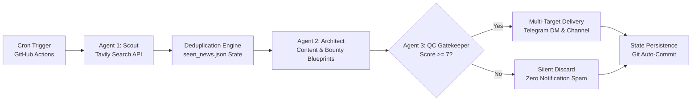

# ⚡ RiyanAgencyBot (`agency-agent`): Autonomous SRE & Opportunity AI Pipeline

[](https://github.com/riyankhamdani/agency-agent/actions)
[](https://www.python.org/downloads/)

An autonomous, serverless multi-agent pipeline that transforms real-time cloud post-mortems, security CVEs, and active developer bounties into **ready-to-execute inbound content and MVP blueprints**—delivered directly to Telegram with zero infrastructure overhead.

Designed with a 3-agent relay architecture (**Scout → Architect → QC Gatekeeper**), stateful deduplication, and dynamic multi-model LLM fallback.

---

## 🏗️ Multi-Agent Architecture & Pipeline Flow

Instead of dumping raw news feeds, the pipeline operates as an automated 3-stage digital agency running on GitHub Actions cron schedules:



---

## 🎯 Key Engineering Highlights

- **3-Agent Relay Pipeline (`Scout` → `Architect` → `QC`):**
  - **Scout:** Ingests fresh cloud/Kubernetes incident retrospectives, CVEs, and live hackathons/bounties via Tavily.
  - **Solutions & Content Architect:** Synthesizes high-impact incidents into ready-to-post LinkedIn/X thought-leadership drafts and breaks down active bounties into 3-step technical MVP blueprints.
  - **QC Gatekeeper:** Scores output quality (`1–10`) via structured JSON evaluation; suppresses low-signal alerts (`score < 7`) while still recording seen URLs to prevent reprocessing.
- **Dynamic Model Fallback Resilience:** Gracefully switches across active Gemini models (`gemini-2.5-flash`, `gemini-2.0-flash`, `gemini-1.5-flash`, `gemini-2.5-pro`, etc.) with exponential backoff and jitter on quota or deprecation errors.
- **Stateful Ingestion & Zero Noise:** Maintains a normalized URL registry (`seen_news.json`) committed back into version control to guarantee zero duplicate alerts across cron intervals.
- **Dual-Path Broadcast:** Concurrently dispatches executive briefings to private Telegram DMs and public community channels.
- **100% Serverless:** Runs entirely on GitHub Actions with zero persistent compute or hosting costs.

---

## 🛠️ Tech Stack

- **Runtime:** Python 3.10+
- **Orchestration:** GitHub Actions Cron Workflows
- **Search & Ingestion:** Tavily API
- **Multi-Agent Synthesis & QC:** Google GenAI SDK (`google-genai`)
- **Messaging Delivery:** Python Telegram Bot API (`pyTelegramBotAPI`)
- **State Store:** Git-persisted JSON state (`seen_news.json`)

---

## ⚙️ Environment Configuration

Configure the following secrets in your repository settings (`Settings -> Secrets and variables -> Actions`):

| Variable | Description |
|---|---|
| `GEMINI_API_KEY` | Google AI Studio API Token |
| `TAVILY_API_KEY` | Tavily Search API Token |
| `TELEGRAM_BOT_TOKEN` | Telegram Bot Token from `@BotFather` (`RiyanAgencyBot`) |
| `TELEGRAM_CHAT_ID` | Personal chat ID for direct executive briefings |
| `TELEGRAM_CHANNEL_ID` | Target channel username or ID |

---

## 🚀 Local Execution

```bash
# Clone the repository
git clone [https://github.com/riyankhamdani/agency-agent.git](https://github.com/riyankhamdani/agency-agent.git)
cd agency-agent

# Install dependencies
pip install -r requirements.txt

# Run in manual cron mode
python agent.py --cron
```
