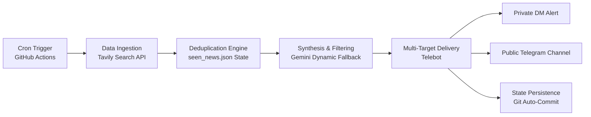

# ⚡ News-Agent: SRE & Cloud Incident Intelligence Pipeline

[](https://github.com/riyankhamdani/News-Agent/actions)
[](https://www.python.org/downloads/)

An automated, serverless intelligence engine aggregating production incidents, cloud post-mortems, security CVEs, and active hackathons into high-signal executive digests delivered directly to Telegram.

Designed with zero-maintenance, cloud-native resilience, and multi-model LLM fallback.

---

## 🏗️ Architecture & Pipeline Flow

The workflow runs on a serverless GitHub Actions cron schedule, ingesting real-time data, filtering state duplicates, synthesizing takeaways via Gemini, and dispatching multi-target alerts.



---

## 🎯 Key Engineering Highlights

- **Dynamic Model Fallback Resilience:** Gracefully switches across Gemini models (`gemini-2.5-flash`, `2.0-flash`, `1.5-flash`, etc.) with exponential backoff and jitter if quota or deprecation errors occur.
- **Stateful Ingestion & Zero Noise:** Maintains a normalized URL registry (`seen_news.json`) committed back into version control to guarantee zero duplicate alerts across cron intervals.
- **Strict Content Filtering:** LLM prompt enforces rejection of stale/concluded hackathons and distills complex infrastructure outages into 1–2 sentence root cause takeaways.
- **Dual-Path Broadcast:** Concurrently delivers personal operational notifications and synchronizes public broadcasts to Telegram community channels.
- **100% Serverless:** Runs without persistent compute infrastructure or hosting costs.

---

## 🛠️ Tech Stack

- **Runtime:** Python 3.10+
- **Orchestration:** GitHub Actions Cron Workflows
- **Search & Ingestion:** Tavily API
- **LLM Synthesis:** Google GenAI SDK (`google-genai`)
- **Messaging Delivery:** Python Telegram Bot API (`pyTelegramBotAPI`)
- **State Store:** Git-persisted JSON state

---

## ⚙️ Environment Configuration

The pipeline requires the following secrets configured in repository settings (`Settings -> Secrets and variables -> Actions`):

| Variable | Description |
|---|---|
| `GEMINI_API_KEY` | Google AI Studio API Token |
| `TAVILY_API_KEY` | Tavily Search API Token |
| `TELEGRAM_BOT_TOKEN` | Telegram Bot Token from `@BotFather` |
| `TELEGRAM_CHAT_ID` | Personal chat ID for direct alerts |
| `TELEGRAM_CHANNEL_ID` | Target channel username or ID |

---

## 🚀 Local Execution

```bash
# Clone the repository
git clone [https://github.com/riyankhamdani/News-Agent.git](https://github.com/riyankhamdani/News-Agent.git)
cd News-Agent

# Install dependencies
pip install -r requirements.txt

# Run in manual cron mode
python agent.py --cron
```
